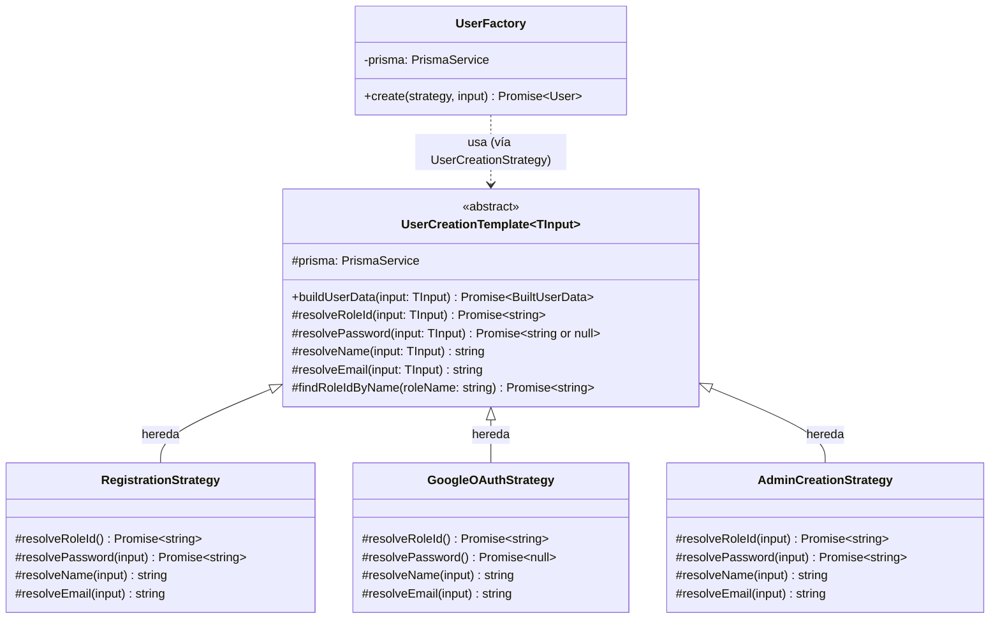

# Justificación de los patrones de comportamiento

## Patrón 1: Template Method (creación de usuarios)

### El problema

En `docs/patrones-creacionales/justificacion.md` ya se documentó que el proyecto tiene tres formas de crear un `User` — registro público, login con Google y creación desde el panel de admin — resueltas con Factory Method: cada una implementa `UserCreationStrategy<TInput>.buildUserData(input)` y entrega un `BuiltUserData` listo para persistir.

Lo que ese patrón no resolvía es que las tres implementaciones de `buildUserData` repetían, cada una por su cuenta, la misma secuencia de pasos:

1. Resolver el `roleId` (buscando un rol por nombre en la base de datos y lanzando `NotFoundException` si no existe).
2. Resolver el `password` (hasheado con bcrypt, o `null` si no aplica).
3. Resolver el `name` y el `email`.
4. Armar y devolver el objeto `BuiltUserData`.

El paso 1 en particular estaba copiado casi literal en `RegistrationStrategy`, `GoogleOAuthStrategy` y `AdminCreationStrategy`: las tres hacían `this.prisma.role.findUnique({ where: { name } })` y lanzaban el mismo tipo de excepción si no encontraban el rol. Solo cambiaba *qué nombre de rol* buscaban — pero el **cómo** buscarlo y validarlo estaba triplicado. Si alguien necesitara cambiar esa validación (por ejemplo, agregar un log cuando un rol no existe), tocaría editar tres archivos y confiar en que los tres cambios queden idénticos.

### Por qué Template Method resuelve esto

Template Method separa el **esqueleto fijo** de un algoritmo (el orden de los pasos) de los **pasos que varían** entre casos. El esqueleto se define una sola vez, en un método que las subclases no pueden tocar; cada subclase solo implementa los pasos abstractos que le son propios.

Acá el esqueleto fijo es `buildUserData()`: siempre resuelve rol → password → nombre → email, en ese orden, y siempre devuelve la misma forma de objeto. Eso se mueve a una clase abstracta (`UserCreationTemplate<TInput>`) de la que las tres estrategias ahora heredan. Lo que cada una decidía distinto queda en 4 métodos abstractos (`resolveRoleId`, `resolvePassword`, `resolveName`, `resolveEmail`), y lo que las tres hacían **igual** — buscar un rol por nombre y validar que exista — queda en un único método concreto compartido (`findRoleIdByName`), que ya no vive triplicado.

Esto resuelve el problema concreto de arriba: la lógica de "buscar rol y validar que exista" vive en un solo lugar (`UserCreationTemplate.findRoleIdByName`), y cambiarla afecta a las tres estrategias automáticamente, sin tocarlas una por una.

### Diagrama UML



### Correspondencia con los participantes del patrón (GoF)

| Participante GoF | Clase en el dominio | Rol |
|---|---|---|
| **AbstractClass** | `UserCreationTemplate<TInput>` | Define el método plantilla (`buildUserData`), los pasos abstractos que varían, y el paso concreto compartido (`findRoleIdByName`). |
| **Template Method** | `buildUserData(input)` | El esqueleto fijo: resuelve rol → password → nombre → email y arma el `BuiltUserData`. Ninguna subclase lo sobreescribe. |
| **Primitive Operations** | `resolveRoleId`, `resolvePassword`, `resolveName`, `resolveEmail` | Los pasos abstractos: cada subclase decide cómo resolverlos. |
| **ConcreteClass** | `RegistrationStrategy`, `GoogleOAuthStrategy`, `AdminCreationStrategy` | Implementan las Primitive Operations: rol fijo vs. elegido, con o sin password, nombre directo vs. con fallback al email. |

### Adaptación al dominio

1. **`UserCreationTemplate` es una clase abstracta, no una interfaz.** Template Method necesita que el método plantilla tenga cuerpo real (no solo firma) y que las subclases comparten estado (`prisma`, inyectado una sola vez en la clase base) y un método concreto (`findRoleIdByName`) — ninguna de las dos cosas es posible con una interfaz de TypeScript.

2. **Contraste con el Factory Method de la Entrega 1 (mismo código, relación distinta):** en `patrones-creacionales/justificacion.md` se documentó que `UserFactory` se relaciona con las estrategias por **composición** (las recibe inyectadas, no hereda de ellas), justamente para seguir Dependency Inversion. Acá, en cambio, las tres estrategias sí se relacionan con `UserCreationTemplate` por **herencia** — es la relación "de libro" que pide el GoF para este patrón, y tiene sentido porque lo que se comparte no es un contrato (eso ya lo daba `UserCreationStrategy`), sino una implementación parcial del algoritmo.

3. **Cada subclase declara su propio constructor, aunque solo llame a `super(prisma)`.** Si una subclase de una clase `@Injectable()` no declara constructor propio, TypeScript no emite los metadatos de tipos (`design:paramtypes`) que NestJS necesita para inyectar `PrismaService`.

4. **El comportamiento público no cambió.** `buildUserData(input)` sigue siendo el único método que `UserFactory` conoce, con la misma firma de antes — por eso los tests unitarios que ya existían para las tres estrategias (`registration.strategy.spec.ts`, `google-oauth.strategy.spec.ts`, `admin-creation.strategy.spec.ts`) no necesitaron ningún cambio y siguen pasando.

## Patrón 1: Template Method (creación de usuarios)

### El problema
### Por qué Template Method resuelve esto

### Diagrama UML
```mermaid
classDiagram
class ActivityController {
        +POST /activities(dto)
        +GET /activities(filters)
        +GET /activities/admin(filters)
        +GET /activities/:id(id)
        +PUT /activities/:id(id, dto)
        +PATCH /activities/:id/publish(id)
        +PATCH /activities/:id/cancel(id)
        +DELETE /activities/:id(id)
    }

    class ActivityService {
        +ActivityService(prisma, locationPort)
        +create(dto) ActivityWithLocation
        +findAll(filters) ActivityWithLocation[]
        +findAllForAdmin(filters) ActivityWithLocation[]
        +findOne(id) ActivityWithLocation
        +update(id, dto) ActivityWithLocation
        +publish(id) ActivityWithLocation
        +cancel(id) ActivityWithLocation
        +remove(id) Activity
    }

    class ActivityLocationPort {
        <<abstract>>
        +findAll(filters, includeDrafts) ActivityWithLocation[]
        +findById(id) ActivityWithLocation
        +setCoordinates(id, lat, lng) void
    }

    class ActivityLocationAdapter {
        +ActivityLocationAdapter(prisma)
        +findAll(filters, includeDrafts) ActivityWithLocation[]
        +findById(id) ActivityWithLocation
        +setCoordinates(id, lat, lng) void
    }

    class ActivityDomain {
        <<Context>>
        +id String
        +title String
        +ActivityStatus status
        +canEdit() boolean
        +publish() void
        +cancel() void
        +finish() void
        +expired(now) boolean
    }

    class ActivityStatus {
        <<enumeration>>
        DRAFT
        PUBLISHED
        CANCELLED
        FINISHED
    }

    class ActivityState {
        <<interface>>
        +ActivityStatus status
        +canEdit() boolean
        +publish(activity) void
        +cancel(activity) void
        +finish(activity) void
    }

    class DraftState {
        +status = DRAFT
        +canEdit() true
        +publish(activity) void
        +cancel(activity) void
        +finish(activity) void
    }

    class PublishState {
        +status = PUBLISHED
        +canEdit() true
        +publish(activity) void
        +cancel(activity) void
        +finish(activity) void
    }

    class CancelState {
        +status = CANCELLED
        +canEdit() false
        +publish(activity) void
        +cancel(activity) void
        +finish(activity) void
    }
    class FinishState {
            +status = FINISHED
            +canEdit() false
            +publish(activity) void
            +cancel(activity) void
            +finish(activity) void
        }

    ActivityController --> ActivityService
    ActivityService --> ActivityLocationPort 
    ActivityService ..> ActivityDomain 
    ActivityLocationAdapter --|> ActivityLocationPort

    ActivityDomain --> ActivityStatus
    ActivityDomain ..> ActivityState 
    DraftState ..|> ActivityState
    PublishState ..|> ActivityState
    CancelState ..|> ActivityState
    FinishState ..|> ActivityState


### Correspondencia con los participantes del patrón (GoF)
### Adaptación al dominio


