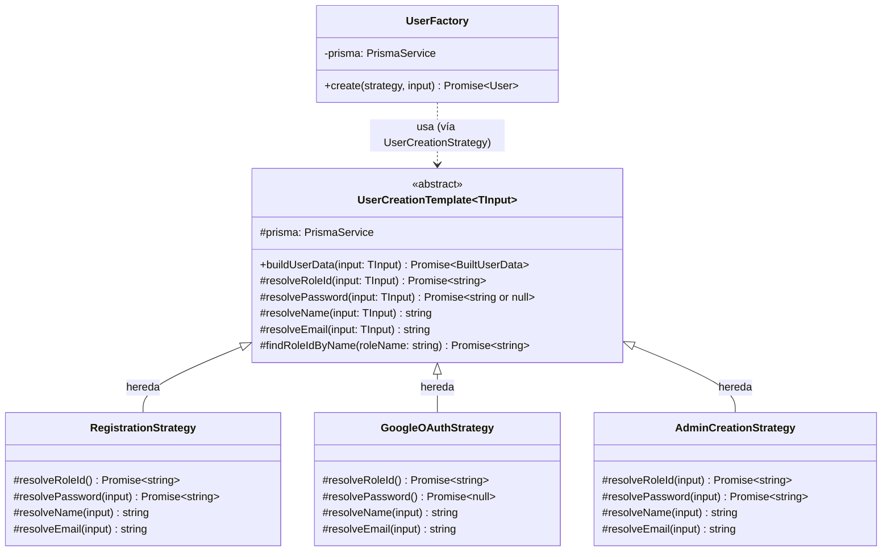
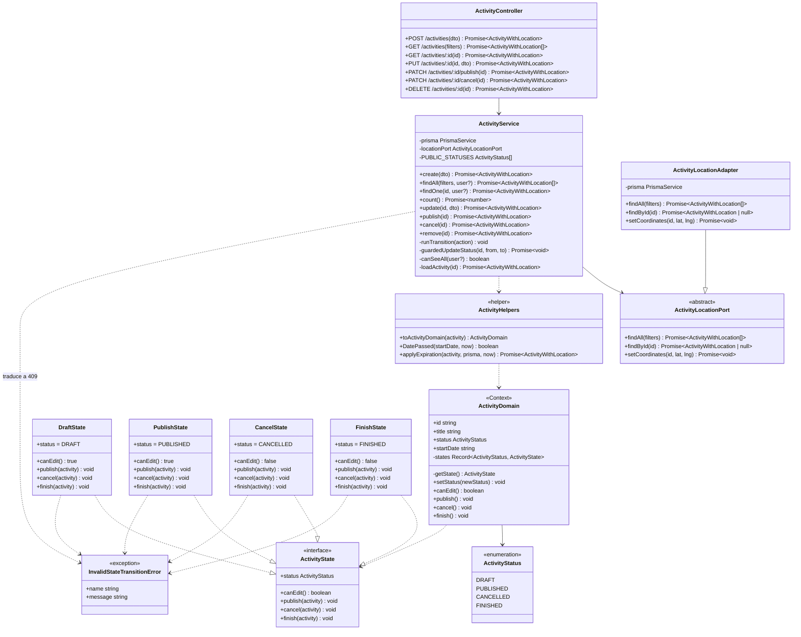

# Justificación de los patrones de comportamiento

## Patrón 1: Template Method (creación de usuarios)

### El problema

En `docs/patrones-creacionales/justificacion.md` ya se documentó que el proyecto tiene tres formas de crear un `User` — registro público, login con Google y creación desde el panel de admin — resueltas con Factory Method: cada una implementa `UserCreationStrategy<TInput>.buildUserData(input)` y entrega un `BuiltUserData` listo para persistir.

Lo que ese patrón no resolvía es que las tres implementaciones de `buildUserData` repetían, cada una por su cuenta, la misma secuencia de pasos:

1. Resolver el `roleId` (buscando un rol por nombre en la base de datos y lanzando `NotFoundException` si no existe).
2. Resolver el `password` (hasheado con bcrypt, o `null` si no aplica).
3. Resolver el `name` y el `email`.
4. Armar y devolver el objeto `BuiltUserData`.

El paso 1 en particular estaba copiado casi literal en `RegistrationStrategy`, `GoogleOAuthStrategy` y `AdminCreationStrategy`: las tres hacían `this.prisma.role.findUnique({ where: { name } })` y lanzaban el mismo tipo de excepción si no encontraban el rol. Solo cambiaba *qué nombre de rol* buscaban — pero el **cómo** buscarlo y validarlo estaba triplicado. Si alguien necesitara cambiar esa validación (por ejemplo, agregar un log cuando un rol no existe), tocaría editar tres archivos y confiar en que los tres cambios queden idénticos.

### Por qué Template Method resuelve esto

Template Method separa el **esqueleto fijo** de un algoritmo (el orden de los pasos) de los **pasos que varían** entre casos. El esqueleto se define una sola vez, en un método que las subclases no pueden tocar; cada subclase solo implementa los pasos abstractos que le son propios.

Acá el esqueleto fijo es `buildUserData()`: siempre resuelve rol → password → nombre → email, en ese orden, y siempre devuelve la misma forma de objeto. Eso se mueve a una clase abstracta (`UserCreationTemplate<TInput>`) de la que las tres estrategias ahora heredan. Lo que cada una decidía distinto queda en 4 métodos abstractos (`resolveRoleId`, `resolvePassword`, `resolveName`, `resolveEmail`), y lo que las tres hacían **igual** — buscar un rol por nombre y validar que exista — queda en un único método concreto compartido (`findRoleIdByName`), que ya no vive triplicado.

Esto resuelve el problema concreto de arriba: la lógica de "buscar rol y validar que exista" vive en un solo lugar (`UserCreationTemplate.findRoleIdByName`), y cambiarla afecta a las tres estrategias automáticamente, sin tocarlas una por una.

### Diagrama UML

### Correspondencia con los participantes del patrón (GoF)

| Participante GoF | Clase en el dominio | Rol |
|---|---|---|
| **AbstractClass** | `UserCreationTemplate<TInput>` | Define el método plantilla (`buildUserData`), los pasos abstractos que varían, y el paso concreto compartido (`findRoleIdByName`). |
| **Template Method** | `buildUserData(input)` | El esqueleto fijo: resuelve rol → password → nombre → email y arma el `BuiltUserData`. Ninguna subclase lo sobreescribe. |
| **Primitive Operations** | `resolveRoleId`, `resolvePassword`, `resolveName`, `resolveEmail` | Los pasos abstractos: cada subclase decide cómo resolverlos. |
| **ConcreteClass** | `RegistrationStrategy`, `GoogleOAuthStrategy`, `AdminCreationStrategy` | Implementan las Primitive Operations: rol fijo vs. elegido, con o sin password, nombre directo vs. con fallback al email. |

### Adaptación al dominio

1. **`UserCreationTemplate` es una clase abstracta, no una interfaz.** Template Method necesita que el método plantilla tenga cuerpo real (no solo firma) y que las subclases comparten estado (`prisma`, inyectado una sola vez en la clase base) y un método concreto (`findRoleIdByName`) — ninguna de las dos cosas es posible con una interfaz de TypeScript.

2. **Contraste con el Factory Method de la Entrega 1 (mismo código, relación distinta):** en `patrones-creacionales/justificacion.md` se documentó que `UserFactory` se relaciona con las estrategias por **composición** (las recibe inyectadas, no hereda de ellas), justamente para seguir Dependency Inversion. Acá, en cambio, las tres estrategias sí se relacionan con `UserCreationTemplate` por **herencia** — es la relación "de libro" que pide el GoF para este patrón, y tiene sentido porque lo que se comparte no es un contrato (eso ya lo daba `UserCreationStrategy`), sino una implementación parcial del algoritmo.

3. **Cada subclase declara su propio constructor, aunque solo llame a `super(prisma)`.** Si una subclase de una clase `@Injectable()` no declara constructor propio, TypeScript no emite los metadatos de tipos (`design:paramtypes`) que NestJS necesita para inyectar `PrismaService`.

4. **El comportamiento público no cambió.** `buildUserData(input)` sigue siendo el único método que `UserFactory` conoce, con la misma firma de antes — por eso los tests unitarios que ya existían para las tres estrategias (`registration.strategy.spec.ts`, `google-oauth.strategy.spec.ts`, `admin-creation.strategy.spec.ts`) no necesitaron ningún cambio y siguen pasando.

## Patrón 1: Template Method (creación de usuarios)

### El problema
El proceso de creación de una actividad no presentaba un ciclo de vida definido, la única regla que simulaba un estado estaba escondida en una consulta SQL dentro de `ActivityLocationAdapter.findAll`, donde simplemente se mostraban las actividades cuya fecha de inicio fuera mayor o igual a la actual. Esto generaba problemas de manera que impedía guardar una actividad como borrador antes de publicarla, cancelarla cuando fuera necesario o bloquear su edición una vez finalizada. Si intentábamos resolverlo agregando un campo status y llenando ActivityService de condicionales (if / else), cada operación tendría que conocer todos los estados y sus transiciones válidas, dejando las reglas regadas por todo el código y haciendo que agregar un estado nuevo fuera propenso a errores.

### Por qué State resuelve esto
El patrón State nos permite encapsular las reglas y transiciones de cada estado (DRAFT, PUBLISHED, CANCELLED y FINISHED) en su propia clase; así nuestro ActivityService se mantiene limpio, cada estado controla qué acciones permite y el sistema puede crecer con nuevos estados sin tener que modificar condicionales por todas partes.

### Diagrama UML

### Correspondencia con los participantes del patrón (GoF)
| Participante GoF | Clase en el dominio | Rol |
|---|---|---|
| **Context** | `ActivityDomain` | Lleva el estado actual `status` y el mapa de estados; expone las acciones (`canEdit, publish, cancel, finish`) y las delega al estado activo pasándose a sí mismo para que pueda cambiarlo. |
| **State** | `ActivityState` | Contrato común que define qué acciones maneja cualquier estado (`canEdit`, `publish`, `cancel`, `finish`). |
| **ConcreteState** | `DraftState`, `PublishState`, `CancelState`, `FinishState` | Cada estado aplica sus propias reglas y lanza error si el cambio no es válido. `CancelState` y `FinishState` scierran el ciclo: no dejan editar ni pasar a otro estado. |
| **Client** | `ActivityService` | Carga la actividad, la arma como `ActivityDomain`, pide la acción y guarda el resultado en base de datos, sin meter lógica de estados. |

### Adaptación al dominio

Aunque seguimos la estructura base del patrón State del GoF (con un contexto, una interfaz de estado y clases concretas por cada estado), adaptamos la implementación para que encajara con nuestra arquitectura web en NestJS y Prisma:

1. **Reconstrucción sin estado en memoria**: En lugar de mantener objetos vivos entre peticiones, guardamos solo un enum en la base de datos y reconstruimos el ActivityDomain en cada operación usando objetos de estado sin datos propios.

2. **Dominio desacoplado y persistencia segura**: Los estados lanzan excepciones propias (`InvalidStateTransitionError`) que el servicio traduce a 409 Conflict, y las transiciones se guardan verificando el estado previo en base de datos para evitar sobrescrituras concurrentes.

3. **Reglas de negocio en el ciclo de vida**: FINISHED se dispara automáticamente al consultar una actividad publicada vencida, y el estado controla tanto la visibilidad en la API como los botones activos en el frontend.

A diferencia de Strategy, donde el cliente elige un comportamiento fijo, aquí la actividad evoluciona dinámicamente pasando de un estado a otro según las reglas de cada etapa.

