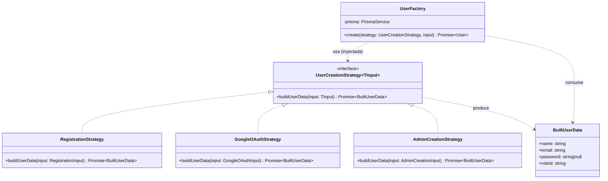
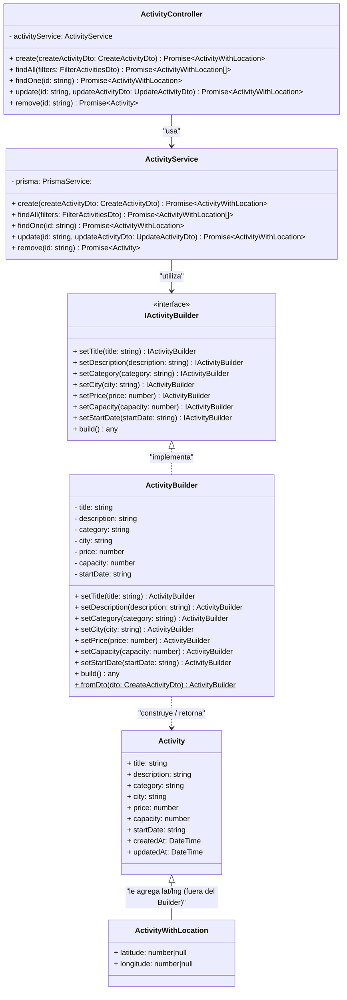

# Justificación de los patrones creacionales

## Patrón 1: Factory Method (creación de usuarios)

### El problema

En el proyecto existen tres formas distintas de crear un `User`, cada una con reglas propias:

1. **Registro público** (`POST /users`): cualquier persona se registra con nombre, email y contraseña. Siempre entra con rol `User` — nadie puede auto-asignarse otro rol desde acá.
2. **Login con Google**: si es la primera vez que alguien entra con su cuenta de Google, se crea el usuario sin contraseña (nunca escribió una) y también con rol `User`.
3. **Creación desde el panel de administrador** (`POST /users/admin`): un admin crea un usuario eligiendo el rol (`User`, `Organizer` o `Admin`). Esta es la única de las tres rutas donde el rol no es fijo.

Antes de resolverlo con un patrón, esta lógica vivía repetida (o parcialmente repetida) en cada servicio que necesitaba crear un usuario: buscar el rol en la base de datos, hashear la contraseña si había una, y armar el objeto final para Prisma. Esto no es solo un problema de "código duplicado" — fue la causa directa de un bug real durante el desarrollo: al renombrar los roles (`'user'` → `'User'`, con mayúscula) en todo el proyecto, quedó un `'user'` hardcodeado suelto en uno de estos puntos, y el registro público se rompió silenciosamente (404 "rol no existe") porque nadie centralizaba esa búsqueda de rol en un solo lugar.

Además, cada forma de creación tiene una entrada distinta (`RegistrationInput`, `GoogleOAuthInput`, `AdminCreationInput`) pero todas terminan en lo mismo: un `User` persistido. Mezclar esas tres variantes en un único método con `if/else` según el "tipo" de creación viola Open/Closed — cada nueva forma de crear un usuario (y ya llevamos tres, con una cuarta casi segura si se agrega registro por otro proveedor OAuth) obligaría a modificar ese método central cada vez.

### Por qué Factory Method resuelve esto

Factory Method separa **"qué variante de los datos hay que construir"** de **"cómo se instancia y persiste el objeto final"**. Cada forma de crear un usuario se convierte en una clase que sabe resolver *su propia* lógica (buscar el rol correcto, hashear o no la contraseña) y la entrega en un formato común; una sola pieza central (`UserFactory`) no necesita saber cuántas variantes existen ni en qué se diferencian — solo pide "los datos ya resueltos" y los inserta.

Esto resuelve los dos problemas concretos de arriba:

- **El bug del rol hardcodeado no puede volver a pasar de la misma forma**: la búsqueda del rol está en un solo lugar por estrategia, no repetida a mano en cada servicio.
- **Agregar una cuarta forma de crear un usuario no toca código existente** (Open/Closed): se agrega una clase nueva que implementa la interfaz, y `UserFactory` sigue exactamente igual. Esto ya se puso a prueba en la práctica: la creación por admin se agregó *después* del registro y Google, sin modificar `UserFactory` ni las otras dos estrategias.

### Diagrama UML

### Correspondencia con los participantes del patrón (GoF)

| Participante GoF | Clase en el dominio | Rol |
|---|---|---|
| **Product** | `BuiltUserData` | El resultado que produce cada variante: los datos ya resueltos (rol encontrado, contraseña hasheada o `null`), listos para persistir. |
| **Creator** | `UserCreationStrategy<TInput>` | Declara el factory method (`buildUserData`) sin saber cómo se implementa en cada caso. |
| **ConcreteCreator** | `RegistrationStrategy`, `GoogleOAuthStrategy`, `AdminCreationStrategy` | Cada una implementa `buildUserData` a su manera (rol fijo vs. elegido, con o sin contraseña). |
| **Client** | `UserFactory` | Recibe cualquier `UserCreationStrategy` (sin saber cuál) y lo usa de forma polimórfica para obtener el `Product`, para luego instanciar y persistir el `User` real en la base de datos. |

### Adaptación al dominio

La diferencia frente al Factory Method "de libro" es deliberada: en el GoF clásico, `Creator` y `ConcreteCreator` se relacionan por **herencia** (el `ConcreteCreator` es una subclase que sobreescribe el método). Acá se relacionan por **composición**: `UserFactory` no hereda de nada, simplemente recibe la estrategia inyectada por constructor (vía el sistema de Inyección de Dependencias de NestJS). Es una adaptación común al implementar Factory Method en frameworks con DI, y además es más alineada con SOLID — en particular con Dependency Inversion, porque `UserFactory` depende de la abstracción `UserCreationStrategy`, nunca de una estrategia concreta.

## Patrón 2: Builder

### El problema
Inicialmente, el modelo de Actividades en el proyecto era sumamente simple y se limitaba a un atributo generalizado (título y descripción).Pero al pensar en la capacidad evolutiva y teniendo en cuenta requerimientos del Reto Medellín, los atributos de las actividades crecieron, agregando nuevos como: Precio, ciudad, capacidad entre otros.

Sin el uso del patrón, gestionar la creación de una actividad traía problemas críticos:

1. **Métodos gigantes**: Al agregar nuevos atributos, los métodos encargados de instancias la actividad terminaban recibiendo una cantidad grande de parámetros, permitiendo la posibilidad de errores humanos al llamarlos.
2. **Lógica condicional dispersa**: Sin un lugar centralizado, el controlador tenía que lidiar con múltiples condicionales para verificar qué datos envió el usuario, asignar valores por defecto y validar la estructura antes de enviarla a Prisma.
3.  **Violación del Open/Closed (OCP)**: Cada vez que el proyecto solicitaba un nuevo atributo para las actividades, se debia modificar directamente la firma y el cuerpo de los métodos de creación, rompiendo código y aumentando el acoplamiento.

### Por qué Builder resuelve esto
El Patrón Builder nos permite configurar los atributos de la actividad de manera independiente y encadenada, permitiendo que el código sea descriptivo y legible. Al implementar este patrón evitamos la contaminación del servicio con lógica repetitiva y además nos permite tener escalabilidad, dándonos la posibilidad de agregar más atributos futuros, sin romper ningún flujo de creación existente.

### Diagrama UML

### Correspondencia con los participantes del patrón (GoF)
| Participante GoF | Clase en el dominio | Rol |
|---|---|---|
| **Client** | `ActivityController` | Expone los endpoints HTTP del CRUD. Recibe las peticiones desde el Frontend (React) con el CreateActivityDto y delega la ejecución al servicio. |
| **Director** | `ActivityService` | Orquesta la construcción de la actividad instanciando o invocando ActivityBuilder, configura los datos y persiste el objeto en la base de datos a través de Prisma. |
| **Builder** | `IActivityBuilder` | Interfaz que declara todos los pasos de posibles configuraciones (setTitle, setPrice, setCapacity, etc.) y el método final build().|
| **ConcreteBuilder** | `ActivityBuilder` | Implementa los métodos de la interfaz, gestiona el estado de la actividad y aplica los valores por defecto, antes de empaquetar el objeto final. |
| **Product** | `Activity(modelo prisma)` | El resultado que produce la construcción: el objeto completo con todos sus atributos resueltos (title, description, category, city, price, capacity, startDate), listo para persistir.|

### Adaptación al dominio
La  diferencia entre el patrón Builder clásico y la adaptación en este proyecto se basa en el propósito y el contexto de su aplicación; en el enfoque clásico el patrón está diseñado para desacoplar la creación de un objeto complejo que requiere múltiples pasos internos(manejando estados intermedios y ensambladores independientes), adaptandola para NestJS y TypeScript  este proceso se simplifica utilizando DTOs para estructurar la entrada de datos, delegando la responsabilidad de orquestación en la capa de servicios (el Director) y conectándose de forma directa con un ORM (Prisma). De esta manera, el patrón se transforma de una estructura rígida a la gestión limpia de la lógica de negocio dentro de una arquitectura web moderna (CRUD).

### Por qué latitude/longitude no entraron al Builder (a propósito)

Cuando se agregó la ubicación de las actividades (para mostrarlas en un mapa), `Activity` sumó una columna `location` de PostGIS (`geography(Point, 4326)`). Esa columna es deliberadamente **`Unsupported`** en el schema de Prisma — Prisma Client no sabe leerla ni escribirla directo como hace con `title`, `price`, etc. Por eso `ActivityService` la maneja aparte, con SQL crudo (`ST_MakePoint` al guardar, `ST_X`/`ST_Y` al leer), **después** de que `ActivityBuilder` arma y persiste el resto de la actividad.

No se metió `latitude`/`longitude` dentro de `IActivityBuilder`/`ActivityBuilder` a propósito: el Builder solo sabe construir lo que Prisma puede insertar de una sola vez (`prisma.activity.create({ data })`). Forzar la ubicación ahí adentro habría significado que el Builder necesitara saber sobre SQL crudo y PostGIS, algo que no es su responsabilidad — justo lo que el patrón busca evitar (mezclar la construcción de datos simples con detalles de infraestructura). Por eso el resultado final que ve quien consume el servicio es `ActivityWithLocation` (`Activity` + `latitude`/`longitude`), pero quien arma esa unión es `ActivityService`, no el Builder — el diagrama de arriba lo muestra como una relación aparte (`Activity <|-- ActivityWithLocation`), fuera de la cadena `ActivityBuilder ..> Activity`.

