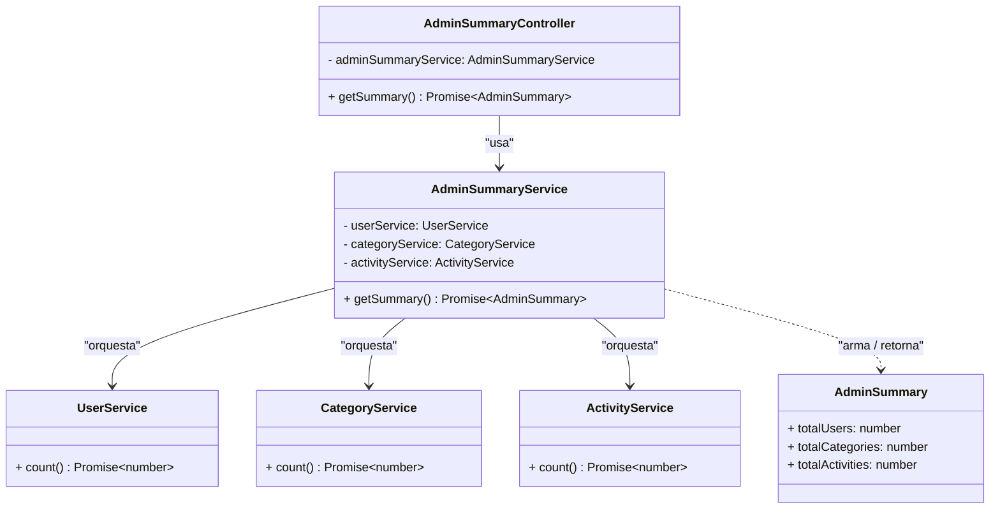
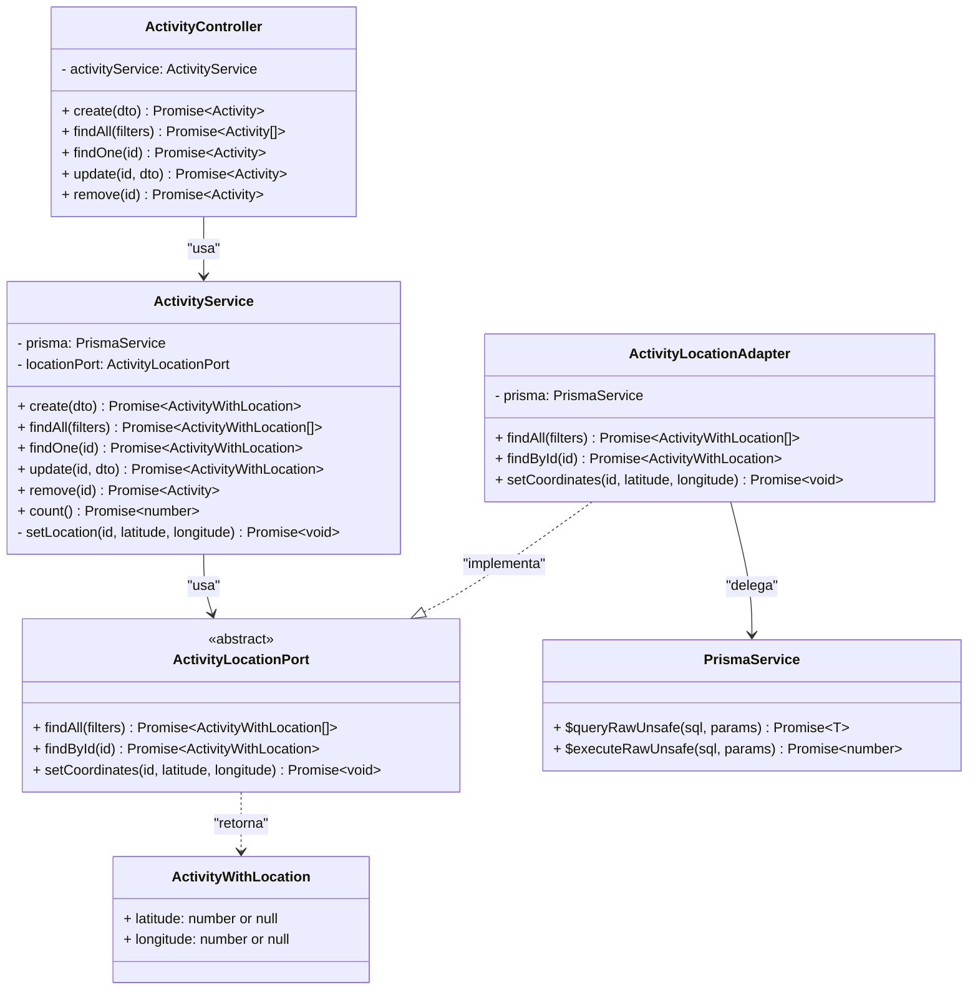
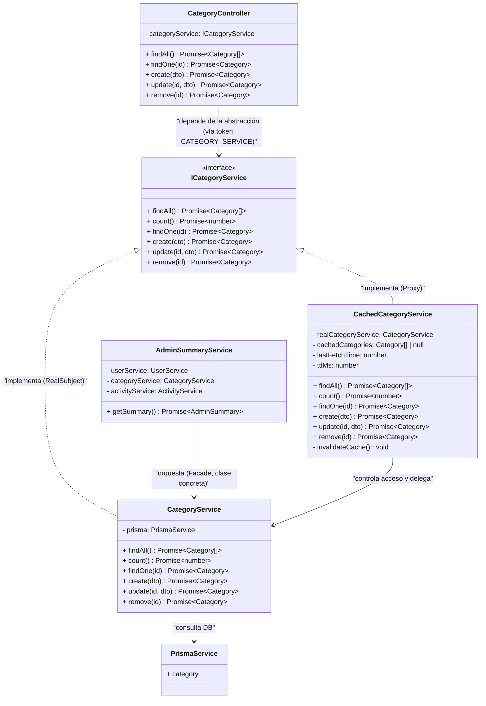

# Justificación de los patrones estructurales

## Patrón 1: Facade (resumen del panel de administración)

### El problema

El panel de administración necesita mostrar, en una sola pantalla, un resumen con el conteo de usuarios, categorías y actividades (las tarjetas de `/admin`). Esa información vive en tres subsistemas completamente independientes — `UserService`, `CategoryService` y `ActivityService` — cada uno con su propio modelo, sus propias reglas de negocio y su propio controller.

Sin un punto de entrada único, resolver esto traía tres problemas concretos:

1. **El frontend tendría que hacer 3 llamadas HTTP distintas** (`GET /users`, `GET /categories`, `GET /activities`) y combinar los resultados por su cuenta cada vez que se necesite el resumen.
2. **El frontend terminaría conociendo detalles internos de cada subsistema** que no le corresponden — por ejemplo, que `GET /activities` por defecto solo devuelve las actividades futuras (así quedó armado para el mapa), algo que un panel de "cuántas actividades existen en total" no debería tener que saber ni filtrar por su cuenta.
3. **Cualquier cambio en cómo se calcula un conteo** (por ejemplo, si más adelante hay que excluir actividades canceladas) obligaría a tocar lógica en el frontend, mezclando presentación con reglas de negocio que no son suyas.

### Por qué Facade resuelve esto

Facade pone una interfaz única y simple delante de un subsistema compuesto por varias piezas, sin que quien la usa necesite conocer cada pieza por separado. `AdminSummaryService` es exactamente esa interfaz: internamente sabe a qué tres services preguntarles y cómo combinar la respuesta — el controller (y, un nivel más arriba, el frontend) solo ven un método, `getSummary()`, que devuelve un objeto plano con los tres totales ya resueltos.

Esto resuelve los tres problemas de arriba: el frontend hace una sola llamada (`GET /admin/summary`), nunca necesita enterarse de cómo cada subsistema calcula su conteo, y si mañana se agrega un cuarto número (por ejemplo, notificaciones pendientes) o cambia la regla de alguno de los tres, el cambio vive adentro del Facade — ni el controller ni el frontend se enteran.

### Diagrama UML

### Correspondencia con los participantes del patrón (GoF)

| Participante GoF | Clase en el dominio | Rol |
|---|---|---|
| **Facade** | `AdminSummaryService` | Ofrece una interfaz única (`getSummary()`) hacia un subsistema de tres piezas que no se conocen entre sí. |
| **Subsistema** | `UserService`, `CategoryService`, `ActivityService` | Cada uno resuelve su propio dominio (usuarios, categorías, actividades) con su propia lógica de negocio; no saben que existe el Facade, ni se conocen entre ellos. |
| **Cliente** | `AdminSummaryController` (y, un nivel más arriba, `AdminPanelPage` en el frontend) | Solo conoce al Facade — nunca llama a `UserService`, `CategoryService` o `ActivityService` directamente. |
| **Resultado simplificado** | `AdminSummary` | El objeto plano (3 números) que el Facade arma a partir de las tres consultas internas, listo para que el frontend lo pinte sin procesarlo más. |

### Adaptación al dominio

En el GoF clásico, el Facade suele envolver un subsistema de clases que viven dentro del mismo módulo o archivo. Acá el "subsistema" está formado por tres módulos de NestJS completamente independientes (`UserModule`, `CategoryModule`, `ActivitiesModule`), cada uno con su propio controller, service y DTOs — así que la adaptación al framework consistió en que cada módulo **exporte** su service (`exports: [UserService]`, y lo mismo en los otros dos), y que `AdminModule` los importe para poder inyectarlos en `AdminSummaryService`. Es el mecanismo que NestJS recomienda para compartir providers entre módulos, en vez de, por ejemplo, que el Facade accediera a Prisma directo y reimplementara ahí la lógica de conteo de cada entidad — así `AdminSummaryService` solo orquesta, nunca duplica reglas de negocio que ya le pertenecen a cada subsistema.

## Patrón 2: Adapter
### El problema

Las actividades incluyen una ubicación geográfica almacenada en la columna location de tipo geography(Point, 4326) (PostGIS). Dado que Prisma no cuenta con soporte nativo para este tipo de datos, los métodos estándar de Prisma (create, findMany, update) no pueden leerlo ni escribirlo de forma directa.

Inicialmente, para resolver este problema, se implementaron consultas SQL directamente dentro de ActivityService. Sin embargo, este enfoque presentaba problemas críticos de arquitectura y mantenibilidad:

1. **Acoplamiento de responsabilidades:** El servicio de negocio conocía detalles de bajo nivel ajenos a su dominio, tales como el orden de los parámetros en ST_MakePoint (longitud antes que latitud), el SRID 4326, y la necesidad de castear explícitamente entre geography al escribir y geometry al leer. Un error en estas consultas no generaba un fallo de compilación, sino errores silenciosos en las coordenadas geográficas.
2. **Dificultad en las pruebas unitarias:** La inclusión de SQL nativo acoplado a la lógica del servicio impedía realizar pruebas unitarias aisladas, exigiendo una instancia real de base de datos con soporte PostGIS para cualquier prueba de creación o consulta (create/findOne).
3. **Duplicación de código (DRY):** La lógica SQL para procesar la ubicación se encontraba dispersa en múltiples métodos (findAll, findOne, setLocation) y duplicada en el script de inicialización (prisma/seed.ts), lo que convertía cualquier modificación en el manejo geoespacial en un cambio propenso a errores y de alto impacto.

### Por qué resuelve esto

El patrón Adapter actúa como un traductor especializado entre componentes con interfaces incompatibles. En este caso, nos permite conectar las limitaciones técnicas de Prisma con PostGIS (la interfaz incompatible) hacia un contrato limpio y esperado por el dominio (ActivityLocationPort), logrando que ActivityService interactúe con las ubicaciones sin necesidad de conocer código SQL.

**Resolviendo cuatro problemas:**
1. **Separación de responsabilidades:** La lógica de negocio queda completamente aislada. Los detalles específicos de PostGIS (orden de parámetros, SRID y casteos) se encapsulan en un único componente (ActivityLocationAdapter).
2. **Capacidad de pruebas:** ActivityService ahora puede someterse a pruebas unitarias de manera aislada utilizando un mock de ActivityLocationPort, sin necesidad de levantar una base de datos con PostGIS.
3. **SQL centralizado:** Toda la lógica de consultas espaciales se concentra exclusivamente en el adaptador.
4. **Bajo acoplamiento y mantenimiento simplificado:** Cualquier modificación futura en la forma de almacenar o procesar las ubicaciones geográficas se limita únicamente al adaptador, dejando intactos el servicio y el controlador.

### Diagrama UML

### Correspondencia con los participantes del patrón (GoF)

| Participante GoF | Clase en el dominio | Rol |
|---|---|---|
| **Cliente** | `ActivityService` | Contiene la lógica de negocio de las actividades. Solo conoce el puerto y nunca sabe que existe PostGIS. |
| **Target** | `ActivityLocationPort` | Interfaz que el cliente espera: findAll, findById y setCoordinates, con latitud y longitud como números planos. |
| **Adapter** | `ActivityLocationAdapter` | Implementa el Target y traduce cada llamada a SQL de PostGIS. |
| **Adaptee (Servicio)** | `PrismaService` | La pieza con la interfaz incompatible: solo habla SQL crudo y no entiende de coordenadas. |

### Adaptación al dominio

En el patrón Adapter clásico (GoF), el Target se define como una interfaz. Sin embargo, dado que las interfaces de TypeScript desaparecen en tiempo de compilación y no pueden utilizarse para la inyección de dependencias, ActivityLocationPort se implementó como una clase abstracta registrada en el módulo correspondiente (ActivitiesModule).

**Decisiones de Diseño y Arquitectura**    
1. **Variante de Adaptador de Objetos:** Se optó por la variante de objetos en lugar de la de clases. ActivityLocationAdapter no hereda de PrismaService, sino que lo recibe mediante inyección de dependencias en el constructor y delega las operaciones en él. Esta elección evita la necesidad de herencia múltiple, la cual no es soportada por TypeScript.

2. **Alcance del Adaptador:** El adaptador encapsula únicamente aquellas operaciones complejas que Prisma no resuelve de forma nativa. Por su parte, ActivityService continúa interactuando directamente con PrismaService para los métodos estándar (create, update, remove y count), ya que estos no involucran el manejo de la columna location.

3. **Verificación de la capacidad de pruebas:** La ventaja de testabilidad del Adapter (poder probar ActivityService sin levantar una base de datos con PostGIS) se validó con `activity.service.spec.ts`, que mockea `ActivityLocationPort` y cubre create, findAll, findOne y update sin ninguna dependencia real de Prisma ni de la base de datos.

**Limitación**
Script de Seed (prisma/seed.ts): Este script mantiene su propia lógica SQL para las ubicaciones debido a que se ejecuta fuera del ciclo de vida de NestJS y, por lo tanto, no puede recibir el adaptador mediante inyección de dependencias.

## Patrón 3: Proxy (caché en memoria de categorías)

### El problema

Las categorías representan datos maestros de la aplicación (ej. *Deportes*, *Música*, *Cultura*, *Gastronomía*) que se modifican muy rara vez, pero cuyo consumo es permanente y masivo a lo largo de casi todos los flujos de la plataforma:

1. **Filtro del mapa de actividades (`ActivitiesMap`):** Cada vez que un usuario entra al mapa principal, el frontend consulta `GET /categories` para poblar el menú desplegable de filtros.
2. **Formularios de actividades (`activityForm` y `EditActivityModal`):** Al crear o editar cualquier actividad, se vuelve a consultar `GET /categories` para armar el `<select>` correspondiente.
3. **Panel de administración (`CategoriesPanel`):** Cada apertura de la sección de categorías vuelve a disparar la petición completa de la lista.
4. **Resumen del panel de administración (el Facade `AdminSummaryService`):** Consulta periódicamente el subsistema de categorías para conocer el estado y conteo de la plataforma.

Sin una capa intermedia que controle el acceso a estos datos, resolver esto traía tres problemas concretos:

1. **Consultas redundantes a la base de datos (I/O innecesario):** Cada llamada a `GET /categories` ejecutaba físicamente `this.prisma.category.findMany()` contra PostgreSQL para traer exactamente los mismos registros una y otra vez, consumiendo conexiones y recursos del motor relacional en lecturas de datos estáticos.
2. **Latencia innecesaria en vistas de alto tráfico:** Componentes visuales críticos como el mapa de eventos se veían obligados a esperar la resolución de la consulta a la base de datos para pintar un simple selector de texto, degradando el tiempo de respuesta percibido por el usuario.
3. **Violación de responsabilidad única si se mezclaba la caché en el servicio de negocio:** Si `CategoryService` gestionara internamente variables de caché en memoria, marcas de tiempo y políticas de expiración, estaría mezclando su responsabilidad esencial (reglas de negocio y persistencia en Prisma) con una preocupación técnica de infraestructura (optimización de acceso y almacenamiento temporal).

### Por qué Proxy resuelve esto

El patrón Proxy proporciona un objeto intermedio (`CachedCategoryService`) que implementa la misma interfaz (`ICategoryService`) que el objeto real (`CategoryService`), interceptando y controlando el acceso hacia él.

El Proxy decide si puede responder de inmediato desde la memoria RAM o si realmente es necesario delegar la consulta a la base de datos:

- Al invocar `findAll()`, el Proxy verifica si ya tiene la lista en memoria y si el tiempo de vida asignado (**TTL - Time-To-Live**, ej. 60 segundos) continúa vigente. Si es válido, retorna la lista en microsegundos sin tocar PostgreSQL.
- Si la memoria está vacía o el TTL ya expiró, delega la llamada al `CategoryService` real, almacena el resultado retornado y actualiza su marca de tiempo.
- **Invalidación activa de caché:** Cuando un administrador crea, actualiza o elimina una categoría (`create`, `update`, `remove`), el Proxy intercepta la operación, delega la persistencia al servicio real e **invalida la caché de forma inmediata** (`cachedCategories = null`).

Esto resuelve los tres problemas de arriba: las consultas frecuentes no tocan PostgreSQL, las vistas del frontend responden al instante, y `CategoryService` se mantiene limpio sin saber que existe una política de caché por delante. Además, la invalidación inmediata asegura que ni el Facade (`AdminSummaryService`) ni los formularios queden mostrando datos obsoletos (*stale data*).

### Diagrama UML

### Correspondencia con los participantes del patrón (GoF)

| Participante GoF | Clase en el dominio | Rol |
| --- | --- | --- |
| **Subject** | `ICategoryService` | Interfaz real (no solo conceptual) que declara el contrato común — `findAll`, `findOne`, `create`, `update`, `remove`, `count`. Es lo que hace posible que el cliente no necesite saber si habla con el proxy o con el servicio real. |
| **Proxy** | `CachedCategoryService` | Implementa `ICategoryService`; controla el acceso a `findAll()` decidiendo si responde desde memoria con TTL o consulta a la base de datos, e invalida la memoria ante operaciones de escritura. |
| **RealSubject** | `CategoryService` | También implementa `ICategoryService`; el servicio original que realiza el trabajo directo contra la base de datos a través de `PrismaService`. |
| **Cliente** | `CategoryController` (y a nivel superior `ActivitiesMap`, formularios de actividad y `CategoriesPanel`) | Depende únicamente de `ICategoryService` (inyectada vía el token `CATEGORY_SERVICE`) — nunca menciona `CachedCategoryService` por su nombre, así que no tiene forma de notar si habla con el proxy o con el real. |
| **Cliente / Orquestador** | `AdminSummaryService` (el Facade) | Caso particular: a este consumidor sí le conviene inyectar `CategoryService` concreto (no el proxy), porque es un conteo administrativo que debe reflejar siempre el dato más fresco de la base de datos, sin pasar por la caché. |

### Adaptación al dominio

1. **Variante de Proxy de Caché:** A diferencia del clásico *Virtual Proxy* (que pospone la creación de un objeto pesado hasta que se necesita) o de un *Protection Proxy* (que verifica permisos de acceso), acá se implementa un **Caching Proxy**. Su objetivo específico es evitar llamadas redundantes a métodos de lectura costosos (`findAll()`) manteniendo una referencia al `RealSubject`.
2. **Inyección de Dependencias en NestJS, por abstracción:** `CategoryController` no depende de `CachedCategoryService` por su clase concreta, sino de la interfaz `ICategoryService` — pero TypeScript borra las interfaces al compilar, así que no sirven como token de inyección por sí solas. La solución (el mismo mecanismo que ya se usa en `AuthService`/`GoogleTokenVerifier` para el login con Google) es un *injection token* explícito: un `Symbol` (`CATEGORY_SERVICE`) que `CategoryModule` enlaza a la implementación real (`{ provide: CATEGORY_SERVICE, useClass: CachedCategoryService }`), e inyectar con `@Inject(CATEGORY_SERVICE)`. Si el equipo alguna vez quisiera apagar la caché, el cambio es una línea en el módulo, no tocar el controller.
3. **El TTL no es un parámetro del constructor:** la primera versión recibía `ttlSeconds` como segundo argumento del constructor con un valor por defecto (`= 60`). Eso rompía el arranque de la aplicación: NestJS intenta inyectar *todos* los parámetros del constructor por tipo, sin excepción para los que tengan un valor por defecto, y no existe ningún provider que resuelva un `number` suelto. El TTL quedó como una constante interna de la clase en su lugar.
4. **Invalidación activa de caché ante mutaciones:** Se implementó una política de invalidación explícita: ante cualquier operación que altere el estado (`create`, `update`, `remove`), el proxy delega la escritura al `RealSubject` y reinicia inmediatamente la variable en memoria (`this.cachedCategories = null`). Esto evita que un administrador cree una categoría y no la vea reflejada de inmediato en los selectores del mapa o en el resumen del Facade.

