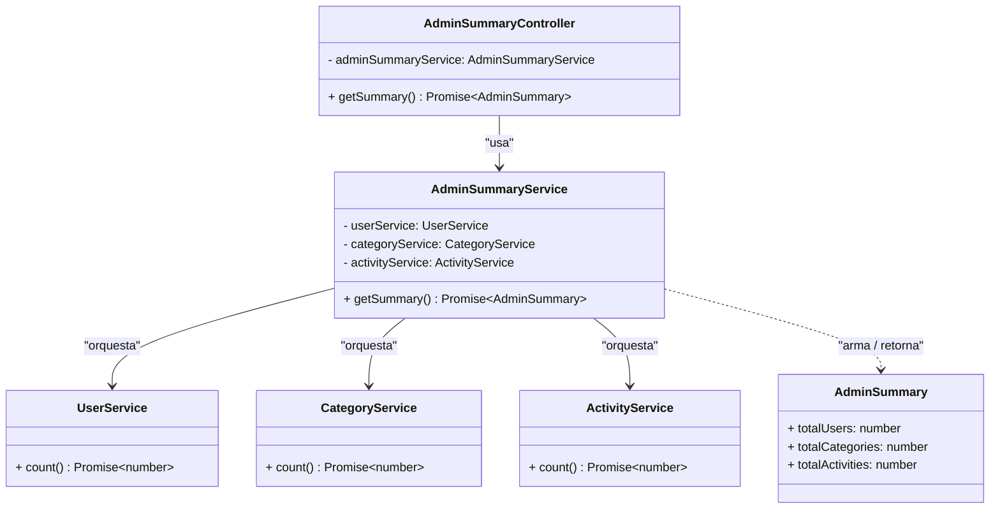

# Justificación de los patrones estructurales

## Patrón 1: Facade (resumen del panel de administración)

### El problema

El panel de administración necesita mostrar, en una sola pantalla, un resumen con el conteo de usuarios, categorías y actividades (las tarjetas de `/admin`). Esa información vive en tres subsistemas completamente independientes — `UserService`, `CategoryService` y `ActivityService` — cada uno con su propio modelo, sus propias reglas de negocio y su propio controller.

Sin un punto de entrada único, resolver esto traía tres problemas concretos:

1. **El frontend tendría que hacer 3 llamadas HTTP distintas** (`GET /users`, `GET /categories`, `GET /activities`) y combinar los resultados por su cuenta cada vez que se necesite el resumen.
2. **El frontend terminaría conociendo detalles internos de cada subsistema** que no le corresponden — por ejemplo, que `GET /activities` por defecto solo devuelve las actividades futuras (así quedó armado para el mapa), algo que un panel de "cuántas actividades existen en total" no debería tener que saber ni filtrar por su cuenta.
3. **Cualquier cambio en cómo se calcula un conteo** (por ejemplo, si más adelante hay que excluir actividades canceladas) obligaría a tocar lógica en el frontend, mezclando presentación con reglas de negocio que no son suyas.

### Por qué Facade resuelve esto

Facade pone una interfaz única y simple delante de un subsistema compuesto por varias piezas, sin que quien la usa necesite conocer cada pieza por separado. `AdminSummaryService` es exactamente esa interfaz: internamente sabe a qué tres services preguntarles y cómo combinar la respuesta — el controller (y, un nivel más arriba, el frontend) solo ven un método, `getSummary()`, que devuelve un objeto plano con los tres totales ya resueltos.

Esto resuelve los tres problemas de arriba: el frontend hace una sola llamada (`GET /admin/summary`), nunca necesita enterarse de cómo cada subsistema calcula su conteo, y si mañana se agrega un cuarto número (por ejemplo, notificaciones pendientes) o cambia la regla de alguno de los tres, el cambio vive adentro del Facade — ni el controller ni el frontend se enteran.

### Diagrama UML



### Correspondencia con los participantes del patrón (GoF)

| Participante GoF | Clase en el dominio | Rol |
|---|---|---|
| **Facade** | `AdminSummaryService` | Ofrece una interfaz única (`getSummary()`) hacia un subsistema de tres piezas que no se conocen entre sí. |
| **Subsistema** | `UserService`, `CategoryService`, `ActivityService` | Cada uno resuelve su propio dominio (usuarios, categorías, actividades) con su propia lógica de negocio; no saben que existe el Facade, ni se conocen entre ellos. |
| **Cliente** | `AdminSummaryController` (y, un nivel más arriba, `AdminPanelPage` en el frontend) | Solo conoce al Facade — nunca llama a `UserService`, `CategoryService` o `ActivityService` directamente. |
| **Resultado simplificado** | `AdminSummary` | El objeto plano (3 números) que el Facade arma a partir de las tres consultas internas, listo para que el frontend lo pinte sin procesarlo más. |

### Adaptación al dominio

En el GoF clásico, el Facade suele envolver un subsistema de clases que viven dentro del mismo módulo o archivo. Acá el "subsistema" está formado por tres módulos de NestJS completamente independientes (`UserModule`, `CategoryModule`, `ActivitiesModule`), cada uno con su propio controller, service y DTOs — así que la adaptación al framework consistió en que cada módulo **exporte** su service (`exports: [UserService]`, y lo mismo en los otros dos), y que `AdminModule` los importe para poder inyectarlos en `AdminSummaryService`. Es el mecanismo que NestJS recomienda para compartir providers entre módulos, en vez de, por ejemplo, que el Facade accediera a Prisma directo y reimplementara ahí la lógica de conteo de cada entidad — así `AdminSummaryService` solo orquesta, nunca duplica reglas de negocio que ya le pertenecen a cada subsistema.

## Patrón 2: _(pendiente — lo documenta otro compañero)_

### El problema

### Por qué resuelve esto

### Diagrama UML

```mermaid
classDiagram

```

### Correspondencia con los participantes del patrón (GoF)

| Participante GoF | Clase en el dominio | Rol |
|---|---|---|
| | | |

### Adaptación al dominio

## Patrón 3: _(pendiente — lo documenta otro compañero)_

### El problema

### Por qué resuelve esto

### Diagrama UML

```mermaid
classDiagram

```

### Correspondencia con los participantes del patrón (GoF)

| Participante GoF | Clase en el dominio | Rol |
|---|---|---|
| | | |

### Adaptación al dominio
