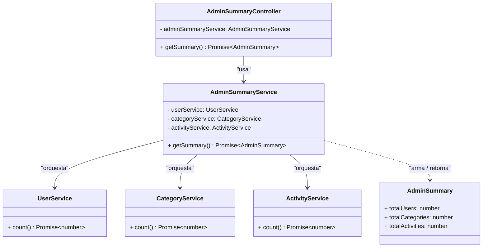
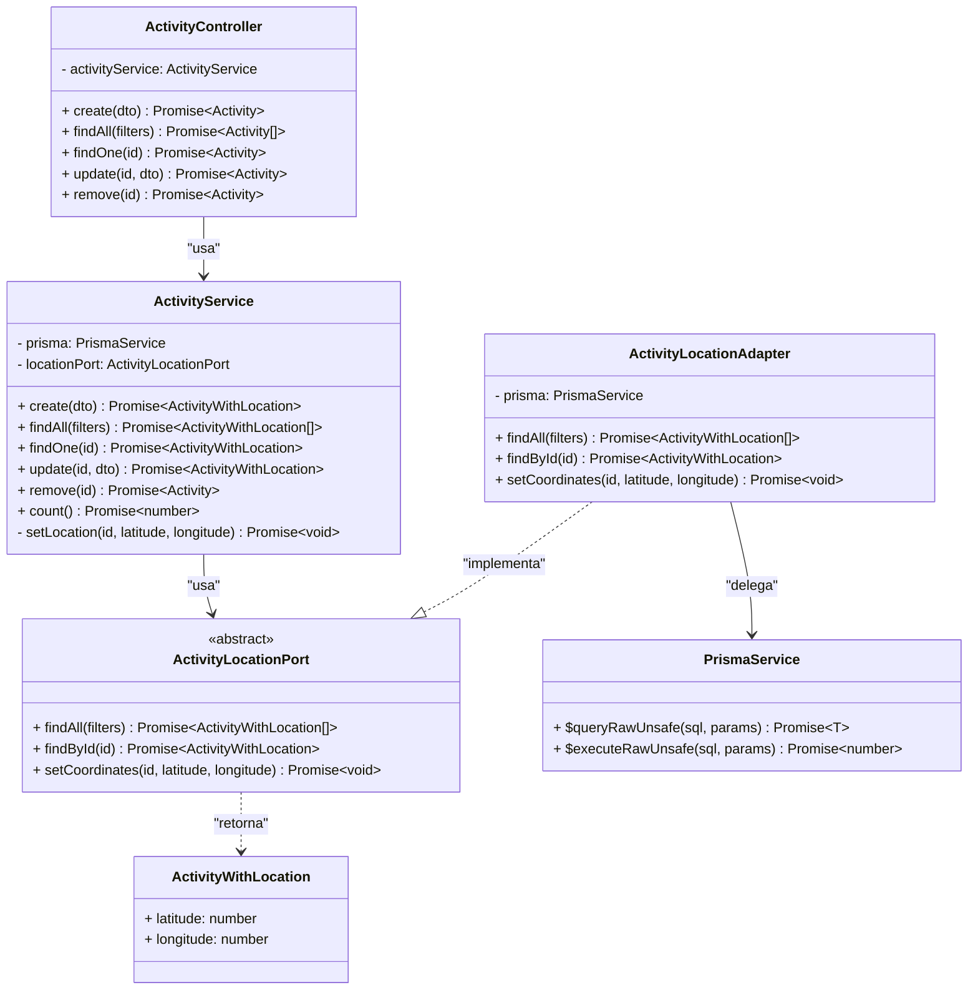

# Justificación de los patrones estructurales

## Patrón 1: Facade (resumen del panel de administración)

### El problema

El panel de administración necesita mostrar, en una sola pantalla, un resumen con el conteo de usuarios, categorías y actividades (las tarjetas de `/admin`). Esa información vive en tres subsistemas completamente independientes — `UserService`, `CategoryService` y `ActivityService` — cada uno con su propio modelo, sus propias reglas de negocio y su propio controller.

Sin un punto de entrada único, resolver esto traía tres problemas concretos:

1. **El frontend tendría que hacer 3 llamadas HTTP distintas** (`GET /users`, `GET /categories`, `GET /activities`) y combinar los resultados por su cuenta cada vez que se necesite el resumen.
2. **El frontend terminaría conociendo detalles internos de cada subsistema** que no le corresponden — por ejemplo, que `GET /activities` por defecto solo devuelve las actividades futuras (así quedó armado para el mapa), algo que un panel de "cuántas actividades existen en total" no debería tener que saber ni filtrar por su cuenta.
3. **Cualquier cambio en cómo se calcula un conteo** (por ejemplo, si más adelante hay que excluir actividades canceladas) obligaría a tocar lógica en el frontend, mezclando presentación con reglas de negocio que no son suyas.

### Por qué Facade resuelve esto

Facade pone una interfaz única y simple delante de un subsistema compuesto por varias piezas, sin que quien la usa necesite conocer cada pieza por separado. `AdminSummaryService` es exactamente esa interfaz: internamente sabe a qué tres services preguntarles y cómo combinar la respuesta — el controller (y, un nivel más arriba, el frontend) solo ven un método, `getSummary()`, que devuelve un objeto plano con los tres totales ya resueltos.

Esto resuelve los tres problemas de arriba: el frontend hace una sola llamada (`GET /admin/summary`), nunca necesita enterarse de cómo cada subsistema calcula su conteo, y si mañana se agrega un cuarto número (por ejemplo, notificaciones pendientes) o cambia la regla de alguno de los tres, el cambio vive adentro del Facade — ni el controller ni el frontend se enteran.

### Diagrama UML



### Correspondencia con los participantes del patrón (GoF)

| Participante GoF | Clase en el dominio | Rol |
|---|---|---|
| **Facade** | `AdminSummaryService` | Ofrece una interfaz única (`getSummary()`) hacia un subsistema de tres piezas que no se conocen entre sí. |
| **Subsistema** | `UserService`, `CategoryService`, `ActivityService` | Cada uno resuelve su propio dominio (usuarios, categorías, actividades) con su propia lógica de negocio; no saben que existe el Facade, ni se conocen entre ellos. |
| **Cliente** | `AdminSummaryController` (y, un nivel más arriba, `AdminPanelPage` en el frontend) | Solo conoce al Facade — nunca llama a `UserService`, `CategoryService` o `ActivityService` directamente. |
| **Resultado simplificado** | `AdminSummary` | El objeto plano (3 números) que el Facade arma a partir de las tres consultas internas, listo para que el frontend lo pinte sin procesarlo más. |

### Adaptación al dominio

En el GoF clásico, el Facade suele envolver un subsistema de clases que viven dentro del mismo módulo o archivo. Acá el "subsistema" está formado por tres módulos de NestJS completamente independientes (`UserModule`, `CategoryModule`, `ActivitiesModule`), cada uno con su propio controller, service y DTOs — así que la adaptación al framework consistió en que cada módulo **exporte** su service (`exports: [UserService]`, y lo mismo en los otros dos), y que `AdminModule` los importe para poder inyectarlos en `AdminSummaryService`. Es el mecanismo que NestJS recomienda para compartir providers entre módulos, en vez de, por ejemplo, que el Facade accediera a Prisma directo y reimplementara ahí la lógica de conteo de cada entidad — así `AdminSummaryService` solo orquesta, nunca duplica reglas de negocio que ya le pertenecen a cada subsistema.

## Patrón 2: Adapter
### El problema

Las actividades incluyen una ubicación geográfica almacenada en la columna location de tipo geography(Point, 4326) (PostGIS). Dado que Prisma no cuenta con soporte nativo para este tipo de datos, los métodos estándar de Prisma (create, findMany, update) no pueden leerlo ni escribirlo de forma directa.

Inicialmente, para resolver este problema, se implementaron consultas SQL directamente dentro de ActivityService. Sin embargo, este enfoque presentaba problemas críticos de arquitectura y mantenibilidad:

1. **Acoplamiento de responsabilidades:** El servicio de negocio conocía detalles de bajo nivel ajenos a su dominio, tales como el orden de los parámetros en ST_MakePoint (longitud antes que latitud), el SRID 4326, y la necesidad de castear explícitamente entre geography al escribir y geometry al leer. Un error en estas consultas no generaba un fallo de compilación, sino errores silenciosos en las coordenadas geográficas.
2. **Dificultad en las pruebas unitarias:** La inclusión de SQL nativo acoplado a la lógica del servicio impedía realizar pruebas unitarias aisladas, exigiendo una instancia real de base de datos con soporte PostGIS para cualquier prueba de creación o consulta (create/findOne).
3. **Duplicación de código (DRY):** La lógica SQL para procesar la ubicación se encontraba dispersa en múltiples métodos (findAll, findOne, setLocation) y duplicada en el script de inicialización (prisma/seed.ts), lo que convertía cualquier modificación en el manejo geoespacial en un cambio propenso a errores y de alto impacto.

### Por qué resuelve esto

El patrón Adapter actúa como un traductor especializado entre componentes con interfaces incompatibles. En este caso, nos permite conectar las limitaciones técnicas de Prisma con PostGIS (la interfaz incompatible) hacia un contrato limpio y esperado por el dominio (ActivityLocationPort), logrando que ActivityService interactúe con las ubicaciones sin necesidad de conocer código SQL.

**Resolviendo cuatro problemas:**
1. **Separación de responsabilidades:** La lógica de negocio queda completamente aislada. Los detalles específicos de PostGIS (orden de parámetros, SRID y casteos) se encapsulan en un único componente (ActivityLocationAdapter).
2. **Capacidad de pruebas:** ActivityService ahora puede someterse a pruebas unitarias de manera aislada utilizando un mock de ActivityLocationPort, sin necesidad de levantar una base de datos con PostGIS.
3. **SQL centralizado:** Toda la lógica de consultas espaciales se concentra exclusivamente en el adaptador.
4. **Bajo acoplamiento y mantenimiento simplificado:** Cualquier modificación futura en la forma de almacenar o procesar las ubicaciones geográficas se limita únicamente al adaptador, dejando intactos el servicio y el controlador.

### Diagrama UML



### Correspondencia con los participantes del patrón (GoF)

| Participante GoF | Clase en el dominio | Rol |
|---|---|---|
| **Cliente** | `ActivityService` | Contiene la lógica de negocio de las actividades. Solo conoce el puerto y nunca sabe que existe PostGIS. |
| **Target** | `ActivityLocationPort` | Interfaz que el cliente espera: findAll, findById y setCoordinates, con latitud y longitud como números planos. |
| **Adapter** | `ActivityLocationAdapter` | Implementa el Target y traduce cada llamada a SQL de PostGIS. |
| **Adaptee(Servicio)** | `PrismaService` | La pieza con la interfaz incompatible: solo habla SQL crudo y no entiende de coordenadas. |

### Adaptación al dominio

En el patrón Adapter clásico (GoF), el Target se define como una interfaz. Sin embargo, dado que las interfaces de TypeScript desaparecen en tiempo de compilación y no pueden utilizarse para la inyección de dependencias, ActivityLocationPort se implementó como una clase abstracta registrada en el módulo correspondiente (ActivitiesModule).

**Decisiones de Diseño y Arquitectura**    
1. **Variante de Adaptador de Objetos:** Se optó por la variante de objetos en lugar de la de clases. ActivityLocationAdapter no hereda de PrismaService, sino que lo recibe mediante inyección de dependencias en el constructor y delega las operaciones en él. Esta elección evita la necesidad de herencia múltiple, la cual no es soportada por TypeScript.

2. **Alcance del Adaptador:** El adaptador encapsula únicamente aquellas operaciones complejas que Prisma no resuelve de forma nativa. Por su parte, ActivityService continúa interactuando directamente con PrismaService para los métodos estándar (create, update, remove y count), ya que estos no involucran el manejo de la columna location.

**Limitación**
Script de Seed (prisma/seed.ts): Este script mantiene su propia lógica SQL para las ubicaciones debido a que se ejecuta fuera del ciclo de vida de NestJS y, por lo tanto, no puede recibir el adaptador mediante inyección de dependencias.

## Patrón 3: 
### El problema

### Por qué resuelve esto

### Diagrama UML

```mermaid
classDiagram

```

### Correspondencia con los participantes del patrón (GoF)

| Participante GoF | Clase en el dominio | Rol |
|---|---|---|
| | | |

### Adaptación al dominio
